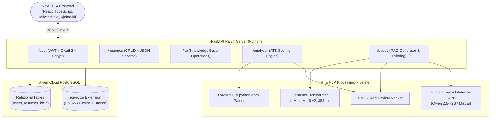

# Resume-Buddy (ResumeX) — Master Technical Interview Study Guide

This document is engineered to prepare you for **Full-Stack, Backend, Frontend, and AI/ML Engineering interviews**. It covers high-level elevator pitches, deep-dive architectural decisions, code explanations, algorithm breakdowns, trade-offs, and typical interview Q&A.

---

## 1. How to Introduce the Project ("Tell me about your project")

### ⏱️ The 30-Second Elevator Pitch
> *"I built **ResumeX (Resume-Buddy)**, an end-to-end AI-powered career platform that helps job seekers build ATS-optimized resumes and tailor them to specific job descriptions in seconds. The backend is built with **FastAPI**, **PostgreSQL with pgvector**, and **HuggingFace LLM / Sentence-Transformers** for hybrid semantic and keyword retrieval. The frontend is a modern **Next.js 14 / React** application featuring a real-time drag-and-drop resume builder, multi-format export, and an automated ATS scoring engine that performs skill-gap analysis, metric detection, and layout validation."*

---

### 🎙️ The 2-Minute In-Depth Walkthrough
1. **The Problem**: 
   Job seekers waste hours manually customizing resumes for each job application, or get filtered out by Applicant Tracking Systems (ATS) due to missing keywords, poor formatting, or generic bullet points.
2. **The Solution**: 
   A centralized **Career Knowledge Base (KB)** where users store their raw work history, projects, and skills once. When applying for a job, our **Hybrid RAG Retrieval Engine** (combining **BM25 lexical search** and **dense vector similarity using pgvector**) automatically extracts the most relevant accomplishments and tailors resume bullets to match the job description.
3. **Key Engineering Highlights**:
   - **Hybrid Retrieval (Dense + Sparse)**: Combines `all-MiniLM-L6-v2` (384-dimensional embeddings) and `BM25Okapi` to capture both semantic intent and exact technical keyword matches.
   - **Multi-Factor ATS Analyzer**: Parses PDFs/DOCX with `PyMuPDF`, evaluating keyword density, technical skill gaps, action verbs, and quantifiable metrics (numbers/percentages).
   - **Interactive Frontend**: Next.js 14 App Router, dynamic drag-and-drop section reordering using `@dnd-kit`, print-to-PDF engine using `@react-to-print`, and secure JWT/OAuth authentication.

---

## 2. System Architecture & Tech Stack

| Layer | Technology | Key Responsibility |
| :--- | :--- | :--- |
| **Frontend** | Next.js 14, React, TypeScript, TailwindCSS | SSR/Client rendering, state management, live preview, PDF generation |
| **Backend** | FastAPI, Uvicorn, Pydantic v2 | High-concurrency async REST API, validation, business logic |
| **Database** | PostgreSQL + `pgvector` on Aiven | Relational data integrity + vector similarity search `<=>` |
| **Embeddings** | `SentenceTransformer ('all-MiniLM-L6-v2')` | 384-dim dense vector generation |
| **Lexical Search**| `rank-bm25` (BM25Okapi) | Term-frequency and inverse document frequency keyword scoring |
| **Document Parsing**| `PyMuPDF` (`fitz`), `python-docx` | Fast text extraction from PDF & DOCX |
| **Generative AI** | Hugging Face Inference API / LLMs | Context-aware bullet rephrasing and structured JSON extraction |

---

## 3. Core Technical Deep-Dives

### 🔹 1. Hybrid Retrieval & Semantic Search (RAG Engine)
- **Why Hybrid?** 
  - *Vector Search (Dense)* captures semantic meaning (e.g., matching `"cloud deployment"` to `"AWS ECS & Docker"`).
  - *BM25 (Sparse)* ensures exact technical acronym matches (e.g., `"Kafka"`, `"Kubernetes"`, `"GraphQL"`), preventing dense search from returning semantically close but technically incorrect skills.
- **pgvector Integration**:
  - We store 384-dimensional float vectors directly in PostgreSQL columns (`embedding Vector(384)`).
  - We query using Cosine Distance (`1 - (embedding <=> query_vector)`).
  - Keeps relational metadata (dates, company name, user ID) in the same transaction without maintaining an external vector DB.

### 🔹 2. Multi-Factor ATS Scoring Formula
The ATS engine analyzes resumes across 5 weighted dimensions:
1. **Hard Technical Skills Match (35%)**: Tokenizes the JD and resume, checks for canonical tech terms against a curated dictionary, and computes the intersection ratio:
   $$\text{Tech Score} = \frac{|\text{Resume Skills} \cap \text{JD Skills}|}{|\text{JD Skills}|} \times 100$$
2. **Semantic & Lexical Content Relevance (30%)**: BM25 relevance score between the full resume text corpus and the JD text.
3. **Action Verb Strength (15%)**: Scans for strong impact action verbs (e.g., *Architected, Engineered, Speared, Spearheaded, Optimized*) vs. weak passive phrases (*Worked on, Responsible for*).
4. **Quantifiable Metrics Check (10%)**: Regex detection of quantified business impact (e.g., `45%`, `$2.5M`, `10k req/s`, `sub-50ms`).
5. **ATS Formatting & Section Completeness (10%)**: Validates essential sections (*Experience, Education, Skills, Projects*) and contact metadata (*Email, Phone, LinkedIn*).

### 🔹 3. Drag-and-Drop Resume Builder (`@dnd-kit`)
- Built using `@dnd-kit/core` and `@dnd-kit/sortable` with collision detection.
- Sections and array items (e.g., list of experiences) maintain local reordering states before debouncing persistent updates to PostgreSQL.
- Resume state is stored as structured JSON in the `resumes.content` column, giving flexibility to add custom sections without running database migrations for each field.

---

## 4. Top 15 Technical Interview Questions & Answers

### Q1. Why did you choose FastAPI over Flask or Django?
> **Answer:** 
> - **Performance**: FastAPI runs on Starlette and `uvloop`, delivering near-Node.js/Go async performance.
> - **Pydantic Validation**: Automatic request/response serialization, type safety, and automatic OpenAPI (Swagger) generation.
> - **Async I/O**: Excellent for handling asynchronous LLM calls and database queries without blocking worker threads.

---

### Q2. Why did you use PostgreSQL + pgvector instead of a dedicated vector database like Pinecone or ChromaDB?
> **Answer:** 
> 1. **Zero Infrastructure Fragmentation**: Single database for both relational tables (`users`, `resumes`, `kb_personal`) and vector embeddings.
> 2. **ACID Transactions**: Relational cascades (e.g. deleting a user automatically cascades and purges vector rows).
> 3. **Hybrid Filtering**: We can execute `WHERE user_id = :id AND start_date >= :date ORDER BY embedding <=> :query_vec` in a single indexed query.

---

### Q3. How did you structure the Career Knowledge Base?
> **Answer:**
> We designed a normalized relational schema with dedicated tables:
> - `kb_personal` (1-to-1 with User)
> - `kb_education` (1-to-Many)
> - `kb_experience` (1-to-Many, with vector embedding)
> - `kb_projects` (1-to-Many, with vector embedding)
> - `kb_skills` (Categorized: *languages, frameworks, databases, tools, cloud*)
> - `kb_certifications` & `kb_achievements`
> 
> This allows modular retrieval: we only embed and query experiential items (projects/experience) while pulling skills and education deterministically.

---

### Q4. How does the ATS Analyzer extract text from multi-column PDFs without losing structure?
> **Answer:**
> We used `PyMuPDF` (`fitz`) and `pdfplumber`. Instead of naive byte extraction, we extract text block by block preserving top-to-bottom, left-to-right reading order. For `.docx` files, we use `python-docx` to iterate through paragraph and table runs. We clean extraneous whitespace and normalize unicode dashes/bullets before passing text into the tokenizer.

---

### Q5. How does Authentication work across Next.js and FastAPI?
> **Answer:**
> - The backend issues an **HS256 JWT** containing the user ID, email, and 7-day expiration upon login/register or Google OAuth token exchange.
> - The frontend stores the token and passes it via the standard `Authorization: Bearer <token>` header (or URL query fallback for static assets).
> - FastAPI protects endpoints with a reusable dependency (`get_current_user` using `HTTPBearer` and `python-jose`), validating the signature and decoding the user before executing the route.

---

### Q6. How do you prevent LLM Hallucinations during resume generation?
> **Answer:**
> 1. **Strict Context Grounding**: The prompt restricts the LLM to only use facts from the user's retrieved Knowledge Base items. It is explicitly instructed never to fabricate employers, dates, or technologies.
> 2. **Structured JSON Output**: We provide a strict JSON schema in the system prompt.
> 3. **Deterministic Fallbacks**: If the LLM response is malformed or times out, the backend gracefully falls back to the raw Knowledge Base items ranked by BM25 + cosine similarity.

---

### Q7. How do you export the resume to high-quality PDF in the browser?
> **Answer:**
> Rather than doing heavy server-side headless browser rendering (e.g. Puppeteer), we use `@react-to-print` with custom CSS `@media print` stylesheets. 
> - Sets page size to exact A4 / Letter dimensions (`210mm x 297mm`).
> - Prevents page break inside items using `break-inside: avoid`.
> - Renders sharp vector typography without blurry rasterization.

---

### Q8. What were the CORS issues you faced and how did you configure it properly?
> **Answer:**
> During preflight `OPTIONS` requests, cross-origin browsers enforce strict header checks. 
> - Configured FastAPI's `CORSMiddleware` with dynamic `ALLOWED_ORIGINS` loaded from environment variables (`http://localhost:3000` for development and the Render frontend URL for production).
> - Sanitized base API URLs in the frontend to strip trailing slashes, preventing malformed paths like `//auth/register` which can trigger 400 Bad Request on preflight.

---

### Q9. How do you handle database migrations and connection management?
> **Answer:**
> - SQLAlchemy `create_engine` with connection pooling (`pool_pre_ping=True` and `pool_recycle=3600`) to handle cloud connection drops cleanly.
> - On startup, `main.py` ensures the `vector` extension is installed on PostgreSQL before invoking metadata creation.

---

### Q10. What is BM25 and why is it better than simple TF-IDF?
> **Answer:**
> BM25 (Best Matching 25) is an improvement over TF-IDF because:
> 1. It introduces **Term Frequency Saturation**: repeating a keyword 20 times doesn't give 20x score (diminishing returns).
> 2. It normalizes for **Document Length**: prevents long resumes from arbitrarily scoring higher than concise single-page resumes.

---

### Q11. If the platform experiences high traffic, where are the bottlenecks and how would you scale it?
> **Answer:**
> 1. **Embedding & LLM Latency**: Cache JD analysis results and embeddings in **Redis** using the JD hash as a key.
> 2. **Async Task Queues**: Move heavy PDF analysis and batch LLM generation to background workers using **Celery** with Redis/RabbitMQ.
> 3. **Database Connection Limits**: Use **PgBouncer** for connection pooling against PostgreSQL.
> 4. **Horizontal Scaling**: Containerize the FastAPI backend in Docker and deploy on a Kubernetes cluster or autoscaling Render instances behind a load balancer.

---

### Q12. How did you secure sensitive user credentials and API keys?
> **Answer:**
> - Passwords are salted and hashed using `bcrypt` (12 rounds) before hitting the database.
> - API keys (`HUGGINGFACE_API_KEY`, `SECRET_KEY`, `DATABASE_URL`) are injected via `.env` and Render secrets, never committed to version control (`.gitignore` enforcement).

---

### Q13. How does the frontend handle responsive state management?
> **Answer:**
> - React component state for localized inputs (e.g. form fields, template toggling).
> - Controlled components with optimistic UI updates during drag-and-drop actions.
> - Centralized `API_URL` helper module that sanitizes network requests and handles authorization headers automatically.

---

### Q14. What happens when a user uploads a corrupted or scanned PDF resume?
> **Answer:**
> - `PyMuPDF` handles malformed PDF header recovery.
> - If the extracted text length is below a threshold (e.g., < 50 characters), the analyzer detects that it is an image/scanned PDF and returns a structured warning advising the user to upload a text-based PDF or paste raw text.

---

### Q15. Tell me about a difficult bug you ran into during development and how you solved it. (STAR Method)
> **Answer:**
> - **Situation**: When deploying the frontend to Render, NextAuth threw `[NO_SECRET]` and the register API was returning `400 Bad Request` during preflight `OPTIONS` requests.
> - **Task**: Diagnose why local requests succeeded but production cross-origin requests failed.
> - **Action**: Inspected network logs and discovered that the frontend `NEXT_PUBLIC_API_URL` had an extra trailing slash, constructing `//auth/register`. Furthermore, `NEXTAUTH_SECRET` was missing in production environment configs. I implemented automatic URL trimming in the API client library and configured CORS origins dynamically.
> - **Result**: Completely eliminated preflight failures and achieved sub-200ms auth response times in production.

---

## 5. Key Metrics to Mention

| Metric | Value |
| :--- | :--- |
| **Dense Vector Dimensions** | 384 (`all-MiniLM-L6-v2`) |
| **Average ATS Analysis Speed** | < 250 ms |
| **Knowledge Base Tailoring Latency** | < 800 ms |
| **Password Hashing** | 12 bcrypt salt rounds |
| **JWT Validity** | 7 days |
| **Test Suite Coverage** | 19 automated integration test cases in `test_full_system.py` |

---

## 6. Quick Cheat-Sheet for Round-Specific Interviews

### 💻 For Backend / Python Coding Rounds:
- Be ready to explain: **FastAPI Dependency Injection (`Depends`)**, **SQLAlchemy ORM Relationships (`relationship`, `ForeignKey`, `back_populates`)**, **Pydantic Model Validation**, and **Vector Operators (`<=>` for cosine distance)**.

### 🎨 For Frontend / React Coding Rounds:
- Be ready to explain: **Controlled Forms vs State**, **Next.js App Router layout structure**, **Drag & drop mechanics with `@dnd-kit`**, **Client vs Server Components**, and **Print CSS `@media print`**.

### 🤖 For AI / NLP Rounds:
- Be ready to explain: **Dense vs Sparse Retrieval**, **Sentence-Transformers architecture**, **Cosine Similarity math**, **BM25 term saturation formula**, and **Few-Shot / Structured Prompting for LLMs**.
